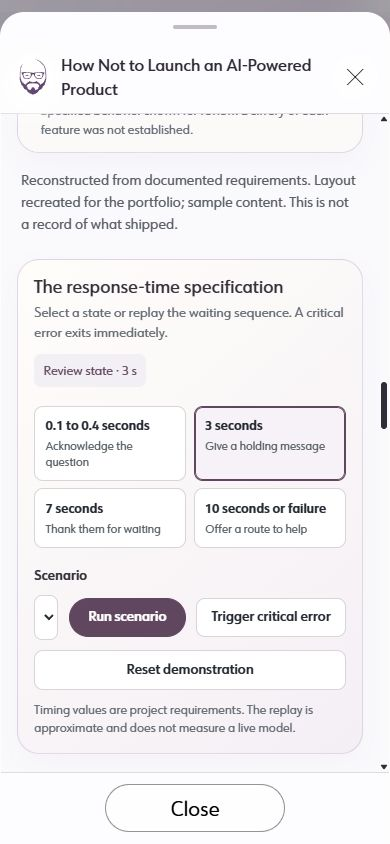

# Usability Audit — AI study

## Executive summary
The mobile demo changes its response above the viewport when the reader selects a timing control. The story also repeats evidence and outcomes, slowing the path through the decisions. Baseline: 96e461e; findings precede the separately authorized implementation.

| Sev4 | Sev3 | Sev2 | Sev1 |
|---|---|---|---|
| 0 | 1 | 1 | 1 |

## Prioritized fixes
- [Keep controls beside feedback](#sev3-controls-and-results-separate)
- [Shorten the reading path](#sev2-repeated-material-buries-the-decisions)
- [Unify card treatments](#sev1-inconsistent-card-treatments)

## Findings
### [sev3] Controls and results separate
**Issue Description:** Mobile readers must scroll back to see the result of selecting a response state. The representative suggestion and draft also occupy separate stacked panels.

**Framework Violation:** Nielsen #1 — Visibility of System Status; Nielsen #6 — Recognition Rather than Recall; Shneiderman #8 — Reduce short-term memory load.

**Severity:** 3. The central interactive explanation loses visible cause and effect.

**Evidence:** At 390×844, selecting “3 seconds” changes the response to “I’m still working on your question.” Its bounding rectangle is y=-98 to -29; controls remain y=406 to 548. Representative separation is source-confirmed, potential — unverified in this audit's live sample: components/case-studies/AIExperience.tsx:177 and AIExperience.module.css:634.

**Recommended Fix:** Combine the scenario, response and compact timing controls in one panel. Put representative guidance and apply action immediately beside the draft, with secondary context expandable.

### [sev2] Repeated material buries the decisions
**Issue Description:** The timing caption appears twice, a link sends the reader back to a preceding demo, and the final outcome repeats the preceding tracking section.

**Framework Violation:** Nielsen #8 — Aesthetic and Minimalist Design; NPCIS — Presentation and Content.

**Severity:** 2. Extra reading and backtracking obscure the ownership and lesson.

**Evidence:** Live modal DOM has two Timing demonstration figures and both the tracking record and Outcome. Source: components/case-studies/AIStudyContent.tsx:10,44.

**Recommended Fix:** Use four headed sections, a short opening verdict and section navigation. Keep each demo or evidence record once; preserve specified-versus-shipped and causal limits.

### [sev1] Inconsistent card treatments
**Issue Description:** AI identity and footer use sentence case beside title-cased neighbors. Summary copy remains visible at the single-column breakpoint.

**Framework Violation:** Nielsen #4 — Consistency and Standards; NPCIS — Presentation.

**Severity:** 1. Visual inconsistency and density, without blocking opening the study.

**Evidence:** Live DOM and user screenshots; components/ui/QuietPrism.module.css:231,419 and docs/ai-chat-study.json identity/theme.

**Recommended Fix:** Apply CSS capitalization to shared identities and themes, preserving acronyms. Hide featured summaries at the existing 820px stacking breakpoint. Give the AI artwork a conversation-specific symbol.

## Walkthrough
### Initial
Opened the AI study on the local homepage, selected a holding-message state at 390px, and measured the response and control positions.

## Appendix
- Mode: hybrid; one live mobile timing interaction plus component and narrative inspection.
- Frameworks applied: Nielsen, Shneiderman, NPCIS. AI heuristics not applicable: deterministic portfolio reconstruction, no live AI/ML behavior.
- Coverage / not inspected: no stored .ux/cujs journeys; no compatible dedicated accessibility auditor configured; no full WCAG assessment. Performance outside requested coverage. Desktop, full demo states, keyboard and post-fix behavior belong to implementation verification.
- Access: public local preview, no login.
