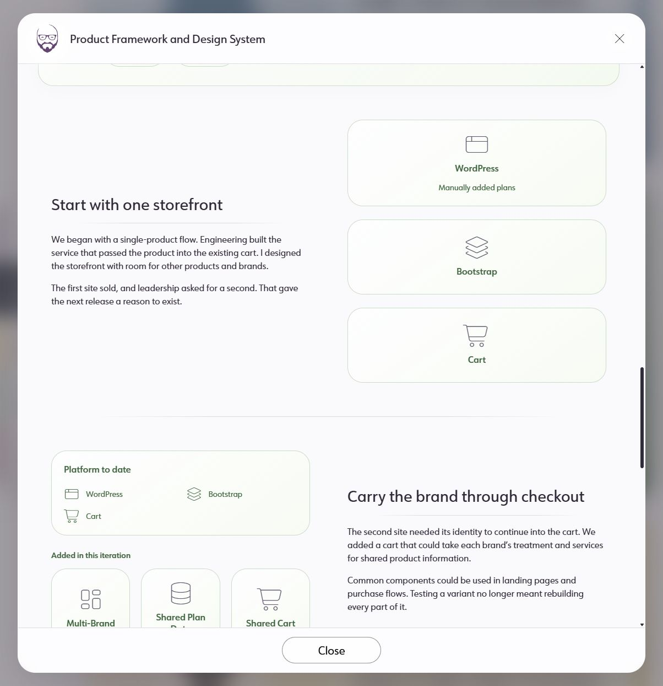
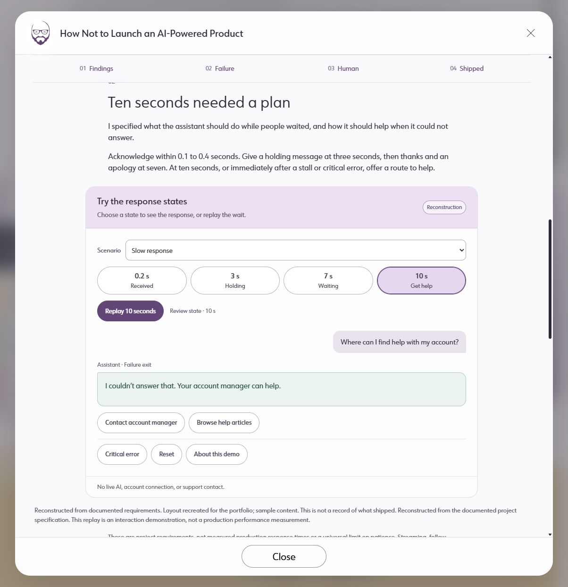

# Usability Audit — Quiet Prism reference and AI modal alignment

## Executive summary
The AI study uses the shared outer modal but a separate visual language inside it.
The Product Framework and Design System modal is the primary reference. This is a
baseline comparison at 545c6fa, before the requested alignment, not release approval.

| Severity | Count |
|---|---:|
| 4 | 0 |
| 3 | 0 |
| 2 | 2 |
| 1 | 1 |

## Prioritized fixes
- [Use the existing reading and evidence patterns](#sev2-reading-pattern-drift)
- [Separate controls, state choices and explanatory labels](#sev2-control-hierarchy)
- [Reuse the site typography, rules and spacing](#sev1-token-drift)

## Findings
### [sev2] Reading pattern drift
**Issue Description:** AI sections are long centered text columns above generic panels. The reference pairs visual evidence with short narrative, using flat peer surfaces and semantic tones. The AI source finding is a bare three-item list, unlike the reference's visible diagrams.
**Framework Violation:** Nielsen #4, Consistency and Standards; NPCIS Presentation and Strategy.
**Severity:** 2. Readers must learn a separate hierarchy within the same portfolio.
**Evidence:** components/case-studies/AIStudyContent.tsx:22; app/visual-system.css:198; reference and AI screenshots below.
**Recommended Fix:** Reuse modal-prism-surface, the narrative/diagram split, faded rules and semantic tone tokens. Map every AI element to a reference or an explicit extension.

### [sev2] Control hierarchy
**Issue Description:** Four response states, replay, help actions and secondary actions all appear as similarly outlined or filled pills. Reconstruction is another outlined pill despite being a passive label.
**Framework Violation:** Nielsen #6, Recognition Rather than Recall; Shneiderman #1, Strive for consistency.
**Severity:** 2. State selection, primary action and supporting information compete for attention.
**Evidence:** components/case-studies/AIExperience.module.css:7; desktop AI screenshot below.
**Recommended Fix:** Use a flat segmented state selector, a distinct primary action, quiet secondary actions, and a plain reconstruction label. Preserve visible selected states and keyboard access.

### [sev1] Token drift
**Issue Description:** AI modules define separate heading sizes, borders, panel radii and purple headers rather than inheriting the same site primitives as the reference.
**Framework Violation:** Nielsen #4, Consistency and Standards; NPCIS Presentation.
**Severity:** 1. The result looks like a separate application despite sharing the outer shell.
**Evidence:** components/case-studies/AIStudyContent.module.css:1; components/case-studies/AIExperience.module.css:4; app/visual-system.css:210.
**Recommended Fix:** Use the shared surface radius, card ink/tint/line variables, section rhythm, thin icons and fading rule. Keep only layout and chat-specific geometry in AI modules.

## Walkthrough

## Appendix
- Mode: hybrid, source inspection and local rendered desktop comparison.
- Frameworks applied: nielsen-10, shneiderman-8, npcis.
- Coverage / not inspected: no stored CUJs exist; journey auditor skipped. No compatible automated accessibility auditor selected; full WCAG conformance unverified. Performance outside requested coverage. AI heuristics not applicable to this deterministic reconstruction. This audit concerns presentation and interaction hierarchy, not model behavior.
- Access: local public preview; no authentication wall.
