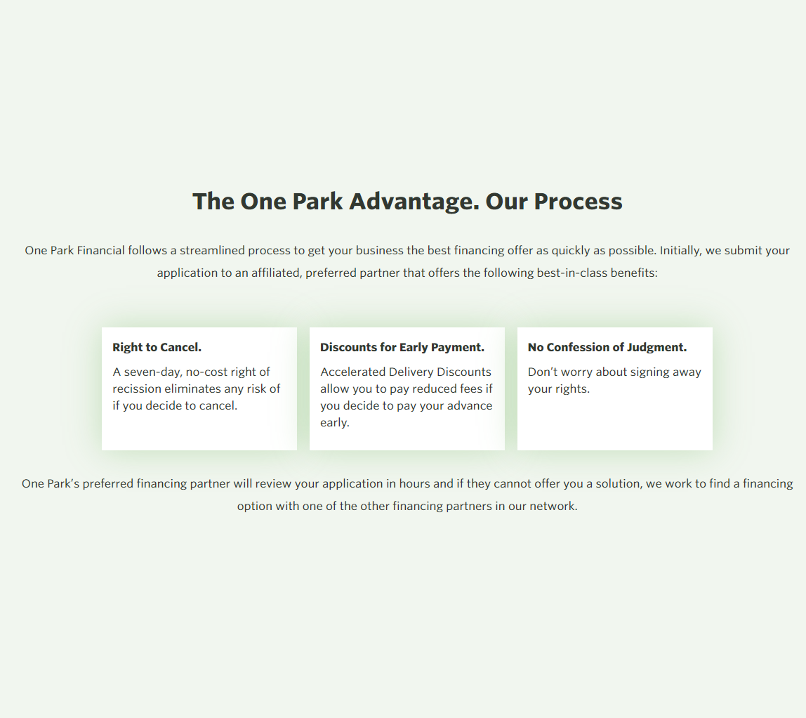
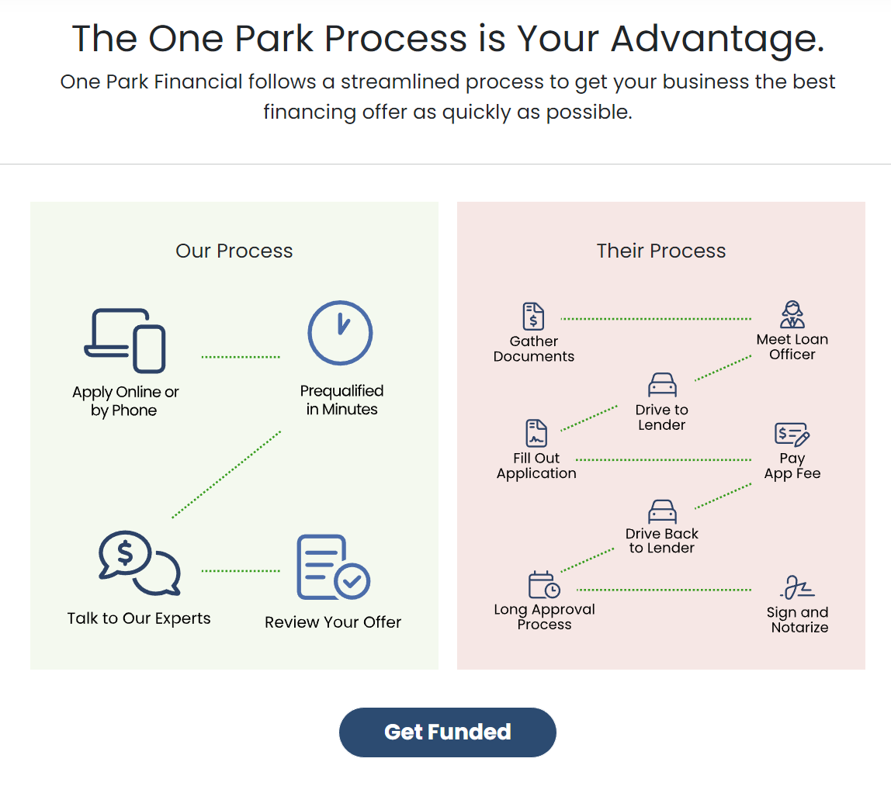
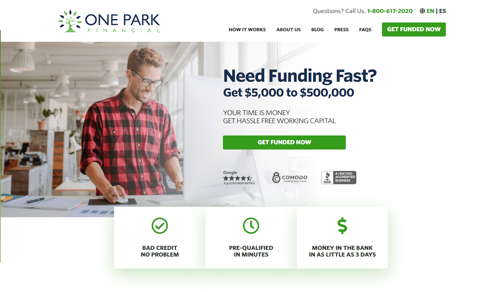
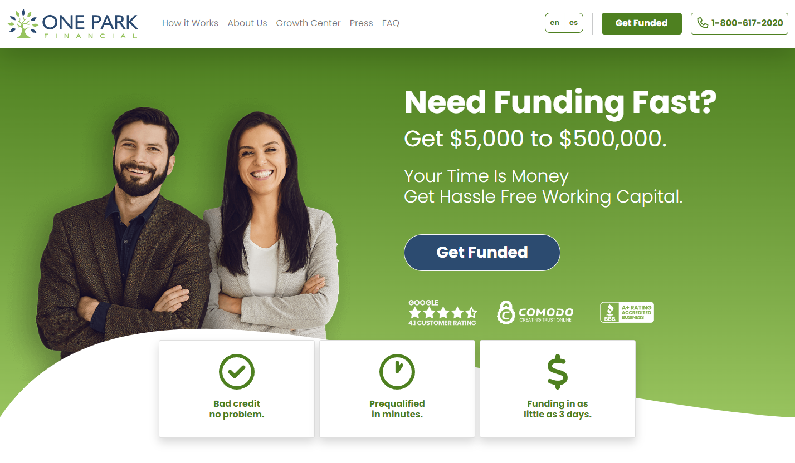

# Usability audit: One Park Financial before and after

## Executive summary
The process module changes from a company description to a customer benefit, replaces prose with illustrated steps, and supplies a next action. The homepage already had funding actions, trust signals and benefit cards; its revision changes their visual prominence. This retrospective review identifies three issues in the old process module and one remaining uncertainty in the revised diagram. Screenshots establish visible changes, not improvements in comprehension, task completion or conversion.

| Severity | Count |
|---|---:|
| 4 | 0 |
| 3 | 0 |
| 2 | 3 |
| 1 | 1 |

## Prioritized fixes
- [Explain the customer benefit](#sev2-company-centered-process-heading)
- [Expose the steps for skimming](#sev2-process-buried-in-prose)
- [Provide a next action](#sev2-no-action-in-the-process-module)
- [Check the diagram's reading order](#sev1-diagram-reading-order-needs-testing)

## Findings
### [sev2] Company-centered process heading
**Issue Description:** The old heading emphasizes the company's advantage and process. The relationship to the customer's task requires reading the supporting text. The potential effect on relevance and comprehension is unverified.
**Framework Violation:** Nielsen #2, Match between the system and the real world; NPCIS Content.
**Severity:** 2. A central service explanation makes the reader work to establish its relevance.
**Evidence:** The initial process image below uses “The One Park Advantage. Our Process.” The revised image uses “The One Park Process is Your Advantage.” Jacob's account identifies partnership and helping customers grow as the brand promise.
**Recommended Fix:** State what the process means for the customer. The revision visibly addresses the heading; it still uses “Our Process” and “Their Process” for the comparison panels. The benefit language should remain supported by the actual service.

### [sev2] Process buried in prose
**Issue Description:** The old module combines long centered paragraphs with three text-only benefit cards. It describes terms and partner handling without a visible step sequence. Difficulty skimming or anticipating the process is potential and unverified.
**Framework Violation:** Nielsen #6, Recognition rather than recall, and #8, Aesthetic and minimalist design; Shneiderman #8, Reduce short-term memory load; NPCIS Presentation.
**Severity:** 2. The reader must reconstruct what happens from prose.
**Evidence:** Initial and revised process images below. The revision has short labels, icons and connectors, with four steps in one panel and eight in the other.
**Recommended Fix:** Make the sequence visible and pair icons with labels. The revision visibly implements this. The old cancellation, early-payment and rights information is absent from this crop; its continued availability elsewhere cannot be established from these images.

### [sev2] No action in the process module
**Issue Description:** The old process crop ends with another paragraph and no visible next action. This finding is limited to the module: the old homepage already has funding buttons. Any lost conversions are unverified.
**Framework Violation:** NPCIS Interaction and Strategy.
**Severity:** 2. A visitor who has finished the explanation must find an action elsewhere.
**Evidence:** Initial process image has no button; revised process image ends with “Get Funded.” Both homepage images separately show funding buttons.
**Recommended Fix:** Put a descriptive action after the explanation. The revision visibly does so. Button behavior, destination and completion remain untested.

### [sev1] Diagram reading order needs testing
**Issue Description:** The revised comparison uses dotted connectors without arrowheads or numbered steps. The right panel alternates across two columns. Whether visitors follow the intended order is potential and unverified.
**Framework Violation:** Nielsen #6, Recognition rather than recall; NPCIS Presentation and Interaction.
**Severity:** 1. Labels provide context, but the path could be clearer.
**Evidence:** Revised process image below, especially the eight-step panel.
**Recommended Fix:** Test the reading sequence at narrow widths. Consider numbered steps or directional connectors if people hesitate. No evidence provided establishes that this was tested or subsequently changed.

## Comparison evidence
These are existing historical image assets, copied without editing. “Revised” identifies the supplied design version, not a verified production outcome.

| Homepage element | Visible change | Limit |
|---|---|---|
| Hero and action | Pale photographic field becomes a green field; a larger blue funding button has a distinct silhouette. | Contrast ratios, click rates and completion were not measured here. |
| Header | Language options become outlined controls; the phone number becomes a separate outlined action. | Touch targets, keyboard use and responsive behavior are not established by the crop. |
| Benefits | Joined cards become separated cards with more space and sentence-case labels. | Both versions already use icons. No measured scanning improvement is available. |
| Content continuity | Funding amount, speed promise, trust marks and three benefit themes remain. | The funding claims and trust marks are historical image content, not verified current offers. |

## Appendix
- Mode: static. Four original repository images visually inspected in full. No historical live site or authenticated system was accessed.
- Frameworks applied: nielsen-10, shneiderman-8, npcis. AI usability lens does not apply to these pages.
- Coverage / not inspected: homepage hero and process module only; no live interactions, heat-map dataset, scroll-map dataset, conversion experiment, accessibility tree, contrast measurement, performance measurement or assistive-technology testing. The other service pages are outside this bounded review.
- Source account: Jacob's October 10 browser comments describe his heuristic evaluation, use of behavioral evidence, and intent to improve clicking, scrolling and skimming. These are attributed project facts, not independently recovered test records.
- Scope: this audit describes historical artifacts. It does not recommend editing the historical screenshots or changing the current One Park website.

