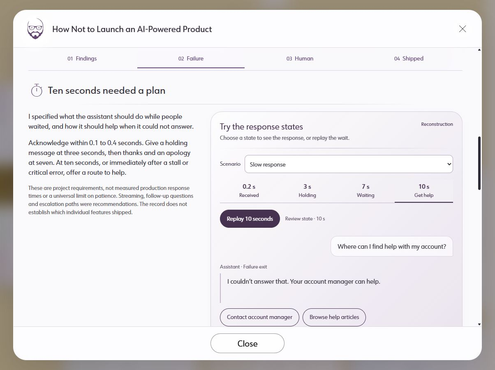
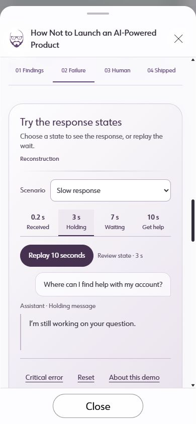
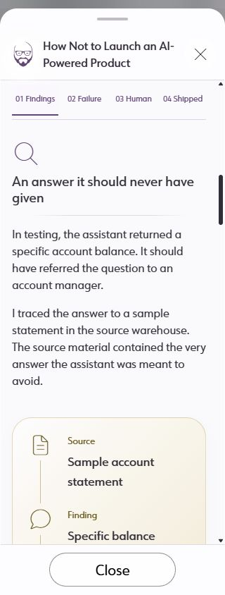

# Quiet Prism: AI study element comparison

Requested by Jacob on October 9, 2026. Reference: the DentalPlans modal titled
**Product Framework and Design System**. Starting AI checkpoint: `545c6fa`.
This comparison covers the complete AI modal, including both demonstrations.

The earlier correction fixed local defects but kept a separate AI visual system.
The new implementation reuses the reference's CSS contracts through
`components/ui/PrismStudy.tsx`; AI modules now concentrate on layout and conversation
geometry. Baseline audit: [findings](../.ux/audits/usability-20261010-030440.md).

## Element map

| Element | Reference pattern | AI baseline | Applied mapping |
|---|---|---|---|
| Dialog shell | Shared translucent header/footer, rounded shell, one scrolling body | Already shared | Retained `CaseStudyModal`; no duplicate modal shell |
| Brand/header title | Jacob mark, readable title, close at right | Already shared | Retained shared header and mobile title wrapping |
| Hero artwork | Project field and circular brand anchor | Conversation artwork and circle | Retained project identity within the same hero anatomy |
| Hero copy | Frosted pane, heading, faded rule, body, contributions | Already shared | Retained shared pane; matching hero/story gutter from prior correction |
| Contribution badges | Small translucent discipline pills | Product and UX Research | Retained; these are metadata, distinct from demo state controls |
| Story introduction | Short narrative before detailed evidence | Long centered column | Opening/context and role metadata form a responsive split |
| Role and collaboration | Supporting context, subordinate to the story | One long metadata row | Compact definition list beside intro; stacks on phone |
| Section navigation | No direct equivalent in reference; shared outline/focus language | Sticky links with no current-section state | Explicit extension: compact links, `aria-current`, underline, keyboard focus and scroll tracking |
| Section heading | `modal-section-heading`, thin icon, site heading scale | Standalone number and a separate heading scale | Shared heading class with thin semantic icon; number stays in navigation |
| Divider | `solid-center`, fading ends | Solid full-width borders | Shared fading rule below each heading and in outcomes |
| Narrative/evidence layout | Short prose paired with visual evidence | Text stacked above every large panel | Two columns when the modal has space, one column below 52rem container width |
| Reading surface | `modal-prism-surface`, 28px radius, tinted gradient, thin border | Independent AI panel palette/radius | `PrismStudySurface` uses that exact shared contract |
| Source finding | Diagram labels and relationships, not decorative charts | Three bare left-border list items | Gold evidence surface with thin source/comment/person icons and connecting line |
| Evidence tones | Gold, sage, plum and slate peer surfaces | Predominantly purple boxes | Gold finding, plum customer demo, slate review/delivery, sage observed use |
| Demo heading | Reading-card heading with rule; no application-like colored toolbar | Solid purple panel header | Plain heading and instructions within the surface, with faded divider |
| Reconstruction label | Subordinate caption/metadata | Pill resembling a control | Plain small label; never focusable or styled as a button |
| Scenario field | Clearly labeled form controls in demonstrations | Native select | Preserved native select, label, 44px minimum height and focus outline |
| Response states | No direct equivalent; selected-state extension | Four pill buttons like actions | Flat segmented selector; underline and `aria-pressed` express selection |
| Primary action | Distinct primary control, readable hover | Same family as many pills | One filled Replay/Stop action; dark hover and white text |
| Help actions | Outlined action convention | Outlined pills | Retained, located beside the response they resolve |
| Secondary actions | Lower emphasis than the main action | Same outlines as help/replay | Underlined Critical error, Reset and About controls with full touch targets |
| Customer message | Domain-specific demonstration, not a site action | Bubble visually close to buttons | Pale asymmetric message bubble with dark text; no action hover or pointer |
| Assistant feedback | Reading content and meaningful state | Tinted response card | Unboxed response with thin leading rule, role/state label and live status |
| Representative context | Supporting details disclosure | Native details | Preserved native disclosure, reference action and focus behavior |
| Language alert | Semantic supporting feedback | Warning card within a panel | Gold warning changes to sage after referral; behavior and labels remain explicit |
| Draft and sample action | Form and error-prevention pattern | Editable textarea and guarded send | Retained input, disabled-before-review state, apply/focus, local sample completion and reset |
| Outcome evidence | Peer cards; sourced metrics where available | Plain two-column prose | Slate Delivery and sage Observed use cards; no invented metric to mimic the reference |
| Captions and limits | Figure captions beside evidence | Present but visually detached in places | Captions remain attached to their figures; scope note stays with explanatory prose |
| Closing | Quiet concluding prose | Centered paragraph | Retained without adding another panel or duplicate navigation |
| Focus and Escape | Shared accessible modal and close behavior | Shared outer modal plus native nested dialogs | Retained; nested Escape returns to its trigger without closing the study |
| Motion | Shared reduced-motion handling; decorative only | Typing dots in replay | Retained reduced-motion rule and timer cleanup; navigation introduces no animation |

## Deliberate differences

The AI study is a qualitative account of specified behavior and observed use. The
reference's revenue metrics, brand logos and architecture bands do not belong in
this story. The AI finding gets a source-to-response sequence; its demonstrations
need input, selection and feedback states. Those extensions inherit the site's
surface and typography rather than reproducing the reference's content.

The full reading page uses the same components inside the shared study styling
context. Its section headings use h2; the modal uses h3 beneath its dialog title.
The public narrative, factual limits and synthetic sample messages are unchanged.
B98 registers only the new live design-system catalog descriptions.

## Reusable result

- [Application contract](quiet-prism-application.md): reference mapping, source
  contracts and acceptance gates to use on the next study.
- [Roadmap](roadmap.md): QP-01 adoption and FUX-01 **Feeral UX** plugin creation.
- `/design-system/`: Study Surface, Study Navigation and Response Demonstration
  show the actual page examples, not detached mockups.

## Verification

Final build and browser evidence are recorded in the acceptance appendix below
and in STATUS. The baseline audit's no-go verdict describes the old design;
it is not a current implementation result or a full-site accessibility judgment.

### Acceptance appendix

- Final `npm run build` passed compilation, lint, types and export. Export validation
  checked 288 images and 104 active references. `git diff --check` passed.
- At 1204px the prose/demo columns measured 408.781px and 613.172px. At 820px,
  390px and 320px the content stacks. No modal-body horizontal overflow was found.
- At 820/390/320px navigation targets remain 44px high. Jump targets receive focus
  and stay below the sticky bar. The bottom-of-story current marker selects Shipped.
- AI and reference gold surfaces have the same 28px radius, 22px padding, border,
  gradient and URW Form/Manrope font stack. Body ink remains neutral; the reference
  metric card deliberately uses gold ink for its metric.
- Primary hover was observed as white text on #34313b. Keyboard Tab produced a
  visible outline on the next section link. Reduced-motion emulation disabled all
  three typing-dot animations. Viewport and media emulation were reset afterward.
- Customer checks: 3-second holding, critical error, help dialog, Escape with return
  focus, replay start/stop, reset to the failure exit. Representative checks: initial
  send disabled, apply referral, focus draft, enabled sample action, local completion,
  reset. No actual messages or model calls were made.
- Standalone route rendered h2 section headings, five shared surfaces, a 28px surface
  radius and no horizontal overflow. The modal retains h3 section headings.
- Catalog Response Demonstration reported “Source located. The page below is live
  and fully interactive.” Its source frame contained the actual Replay control.
- Browser error log was empty after final reload. React review checked hook cleanup,
  passive scroll listener, frame cancellation, stable keys, direct imports, preserved
  timer cleanup and named controls. No dependency changes.
- The audit report/index validators and HTML renderer passed. The audit footprint
  check passed before implementation, with all eight audit writes confined to
  `.ux/audits/`. Subsequent source work was a separate authorized implementation phase.

### Goal completion check

| Requested result | Current evidence |
|---|---|
| Break down Product Framework and Design System | Complete element map above; source and rendered reference inspected |
| Compare each AI element and apply site look/feel | Map covers shell through motion; shared primitives, tokens and responsive implementation inspected in source and browser |
| Solid way to apply Quiet Prism, used on AI study | Application contract plus live catalog entries; shared surface values match the reference |
| Add the method to the roadmap | QP-01 in docs/roadmap.md, with pilot status and wider adoption gates |
| Add UX best-practice plugin creation under Feeral UX | FUX-01 under Feeral UX, with capabilities, stages, ownership/dependencies, boundaries and acceptance evidence |

Full-site accessibility certification, wider modal migration and the future plugin
build are not claimed. The requested roadmap entries are complete; those future
implementation items remain planned. Publication remains separate.
