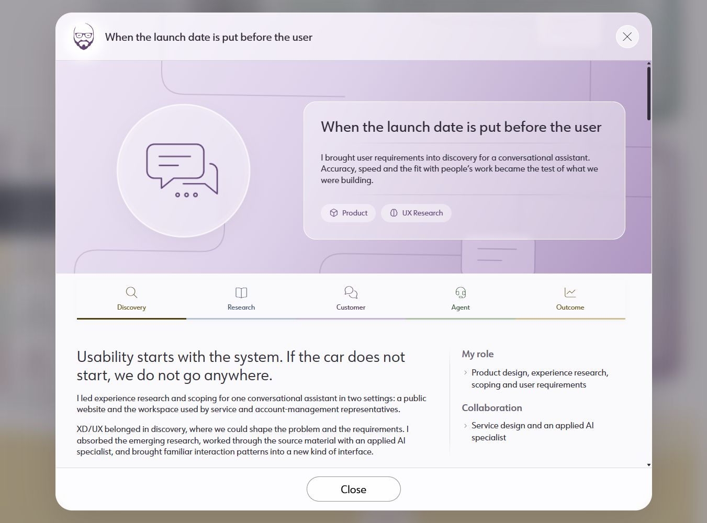

# Release verification — October 22, 2026

## Authorization and scope

Jacob requested deployment on October 21, then explicitly directed inclusion and
merge of all current pending changes on October 22. This includes the October 20
B108 annotations and discovery-flow follow-up, plus the 14 committed changes on
`codex/ai-study-main-20261008` after the previous public release. Other worktrees
are outside this release. The source baseline is
`018f158a996e75f4de80d44d196af0f1e8b2145e` plus the documented pending files.
The previous remote main and production rollback point is
`ee33fe47ab3b385188bdb3446984dd34b8e2ef52`.

No new copy or design changes were introduced during release preparation. B108's
section-separator interpretation is included under Jacob's instruction to include
all changes. Earlier review reports remain historical evidence; this report
supersedes their incomplete release verdict for the checks described here.

## Pre-publication checks

- Fresh production build passed: lint, types and 14 route entries. This export
  includes the final five-column discovery flow and negative description margins.
- AI presentation guard passed on 10 files; all three guard tests passed.
- 288 exported images match source; 104 production asset references passed.
- Design-system validation passed: 59 patterns, 197 examples, 36 tokens.
  An initial invocation during the build read an incomplete stylesheet set;
  rerunning after the build passed. No source fix was needed.
- Export review passed on 13 HTML files with zero issues: metadata, local links,
  anchors, duplicate IDs, image alternatives and stale-title markers.
- Home and AI study layouts checked at 1351, 820, 390 and 320 CSS pixels; no
  horizontal overflow or broken images. Both revised headlines are present.
- All 15 shared StudyIntro instances checked at 1351 and 320 pixels: no overflow;
  metadata labels are 18px. The role label has 10px below and collaboration 8px.
- Research titles clamp to two lines at rest. Keyboard focus reveals the full long
  title with a visible outline. Sticky section navigation moves to its heading.
- Customer replay starts; critical error offers recovery; the account-manager
  route opens its explicit simulation dialog. Back returns focus to the entry.
- Service sending is disabled until review is checked. Sending creates one sample
  reply, resets the draft, and confirms that nothing was sent outside the demo.
  Back returns focus to the entry; modal close returns focus to its home card.
- 320px text-spacing overrides and forced colors inspected. Reduced-motion mode
  exercised during modal checks. Font Awesome headset glyphs render from the Pro
  font. Fresh browser console recorded no errors. All temporary overrides cleared.
- Quiet Prism fixtures passed. The changed study stylesheet has eight static
  review candidates, all retained selectors, colors or overrides from the prior
  approved stylesheet; no new candidate signature was introduced.
- `git diff --check` passed. Deployment workflow retains
  `dangerous-clean-slate: false`.

Actual 400% browser zoom was not verified: the browser shortcut did not change the
CSS viewport. 320px reflow was verified separately. Screen-reader conformance,
other browser engines and performance benchmarking are not claimed.

Evidence: [browser measurements](browser-checks.json),
[export checks](export-checks.json), [desktop research](research-1351.png),
[phone research](research-320.png), [text spacing](text-spacing-320.png),
[forced colors](forced-colors-320.png).

Before publication, ordinary HTTP requests returned 200 for the homepage,
`/musings/`, and `/interaction-design-concepts/response-times/`. Homepage
Last-Modified was October 8, 2026. The static production preview runs from `out/`
on port 8090 in managed session 83753.

## Changed files and coordination

The release includes all current branch changes and the recorded October 20
files: AI study CSS/TSX, shared StudyIntro CSS/TSX, project and study data,
design-system catalog, copy register, audit index/reports/assets, release review
evidence and STATUS. The full release diff is against the rollback commit above.
This verification directory is the only new release evidence directory.

Fresh Genesis STATE confirms the Exchange is retired/read-only. Unique direction
and completion records are kept in `C:/dev/_handoffs/release-20261022/` for the
coordinator; receipt is unverified. No shared coordinator records were edited.

## Publication

Published release: `db9278a6002c056da1b075dfb3e8711c5fbb2fa3`.
The feature branch was checkpointed, then main was fast-forwarded and pushed.
[Deployment run 39722704770](https://github.com/jacobmedley/jacobmedley.com/actions/runs/39722704770)
completed successfully; Build and FTP Deploy took 1m14s. The workflow's nonblocking
notices concern action runtime deprecation and the Ubuntu runner migration.

Ordinary homepage GET returned 200, `X-Proxy-Cache: MISS`, and
`Last-Modified: Thu, 22 Oct 2026 04:31:10 GMT`, matching the deployment. The new
AI title, One Park subtitle and restored HEC entry are present. The anonymous
reading route returns 200 with the new title and no employer/vendor identifiers.
Both protected legacy routes and the sample guide PDF return 200. No purge was
needed. See [HTTP evidence](live-http-checks.json).

The PowerShell HTTP client returned 403 for the homepage twice, while ordinary
curl and Chrome loaded the current page successfully. The client-dependent cause
was not established. No server setting, cache bypass or user-agent override was
used. Live Chrome checks passed: new modal title, rendered headset, no broken
images, HEC and revised employment disclosures, 390px reflow, and no console
errors. Viewport and media overrides were reset. The live tab is left available.

No site-source changes followed publication. This closeout updates evidence,
copy-register publication state and STATUS only; its commit uses `[skip ci]`.
Main is the final checkout. The static preview remains on port 8090, PID 63264,
managed session 83753. The owned lock is released after the closeout commit.
Remaining limits are actual 400% zoom, assistive-technology/other-engine coverage,
the HTTP-client diagnostic above, and unconfirmed coordinator receipt. There is
no remaining merge or deployment work for this request.
