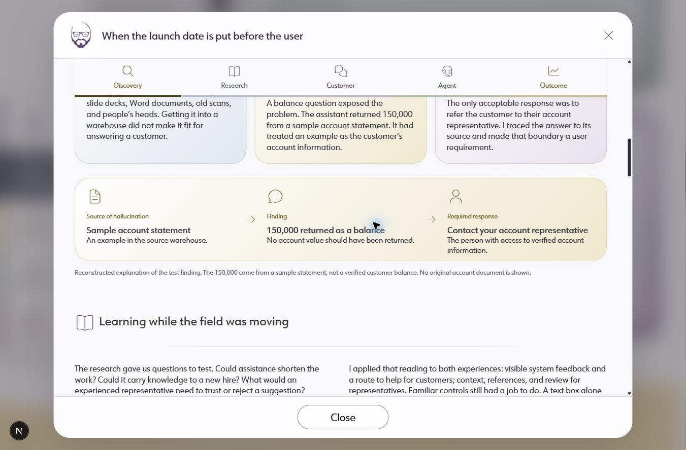
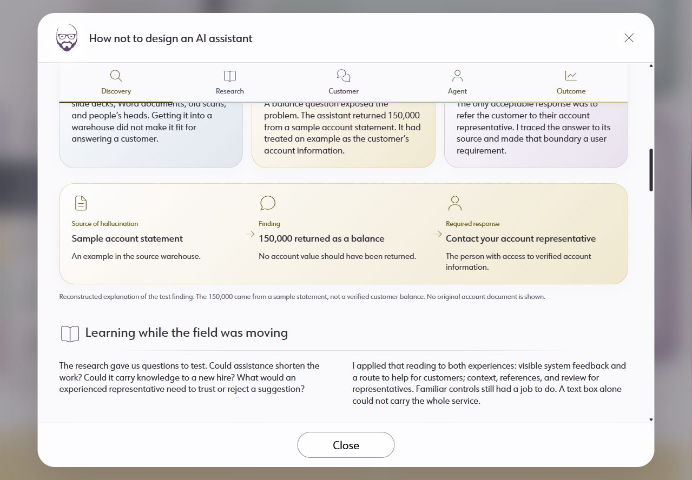

# Release review, October 20, 2026

Status: source edits complete; discovery-flow follow-up verified in the live dev preview. Broader visual release verification remains incomplete. The earlier production export predates this follow-up. Nothing published.

Preview: http://localhost:8090/#work. Use localhost for the configured Font Awesome kit.

Baseline: `018f158a996e75f4de80d44d196af0f1e8b2145e`, branch `codex/ai-study-main-20261008`. Changes remain uncommitted. The pre-existing `docs/STATUS.md` preview note was preserved.

## Annotation mapping

| Comment | Source change | Scope and review note |
|---|---|---|
| 1 | One Park subtitle is **Reading the Signals** | Shared project data, including card and modal |
| 2 | AI title is **When the launch date is put before the user** | Shared JSON feeds the featured card, modal and standalone page; URL retained |
| 3 | Discovery flow now has five grid columns: content, arrow, content, arrow, content | Superseded by Jacob's explicit follow-up; two dedicated 2rem arrow columns, centered vertically |
| 4 | Paper titles clamp to two lines at rest | Full official title remains in the DOM and link title; hover or keyboard focus reveals it |
| 5 | AI section rules receive 1.5–2rem above and below | Interpretation of a region-only annotation; confirm this target visually |
| 6 | Agent uses `fa-thin fa-headset` | Navigation and matching section heading |
| 7 | My role label: 1.125rem (18px), .625rem (10px) bottom margin | Shared StudyIntro component |
| 8 | Collaboration label: 1.125rem (18px), .5rem (8px) bottom margin | Shared StudyIntro component |
| 9 | AI main sections and requirements receive 4–6rem separation; more space after navigation | Local `--section-rhythm` and `--heading-rhythm`; no global rhythm change |

The existing 48rem and 30rem container breakpoints remain. Metadata sizing applies at all widths and does not hard-code the annotation viewport. The discovery connectors point down below 30rem. The design-system catalog documents the changed patterns. No temporary browser attributes were copied into source.

## Content review

- Reviewed the home-page hierarchy, featured copy, current employment presentation, six reading-study summaries and outcomes, and the AI study narrative, research summaries, measurements, limitations and demo labels.
- Checked all 15 active project records for identity and placeholder text. Six featured cards have complete title/subtitle/summary data. Thumbnail records intentionally have a smaller content contract.
- AI JSON differs from the baseline only in its requested title. Project data differs only in the One Park subtitle. Existing measurements, sources, claims, anonymity and reconstructed-demo labels are preserved.
- The finance-attributed 47% is still a share of the company's revenue-growth increment in one measured year. The 72% employment figure remains a directional comparison of delivered output. AI measured response times remain separate from the replay timer and retain the missing-log/sample-window limitation.
- No new private sources were accessed, and no independent verification of historical business results or external citation availability was performed.

Evidence: [content checks](content-checks.json) and [export inventory](export-checks.json).

## Completed checks

| Check | Result |
|---|---|
| TypeScript `tsc --noEmit` | Passed |
| ESLint on `app components lib --quiet` | Passed |
| AI presentation guard | Passed, 10 files |
| Existing AI presentation guard tests | 3 passed |
| Production build, including lint/types | Passed; 14 generated route entries |
| Production export asset validation | 288 images match source; 104 active references verified |
| Design-system manifest | 59 patterns, 197 examples, 36 tokens; no errors |
| Exported HTML checks | 13 HTML files; no missing static local targets/anchors, duplicate IDs, missing alt attributes, title/description omissions, stale headlines or placeholder markers |
| Design-system hash navigation | 59 declared client routes matched against the catalog and source hash handler; browser behavior not reverified |

Windows initially returned EPERM while creating existing build directories. One attempt also found `out` locked by a preview process whose working directory was `out`. That owned preview was stopped. The successful build used the unchanged production configuration with a temporary Node preload that only handles EPERM after verifying the target is already a directory; the successful run emitted no correction messages. No permissions or production source configuration were changed. The preview now uses the Next.js development server on port 8090; the earlier export is not the current follow-up preview.

## Discovery-flow follow-up

Jacob clarified that each arrow must occupy a grid column and requested -12px top and bottom margins on all three descriptions. The source now renders five direct grid children. The arrows are decorative, hidden from accessibility, and the three content entries retain ordered-list semantics. The descriptions use -.75rem block margins. The existing 30rem container breakpoint stacks the same sequence and rotates the arrows down; no viewport-specific annotation styles were added.

Browser access recovered. At 1351px and 820px the computed grid has five columns, including two 32px arrow columns. At 390px and 320px it has one column and downward arrows. All three descriptions compute to -12px top and bottom margins at every checked width, with no discovery-flow horizontal overflow. Desktop and phone screenshots confirm the compact text spacing without overlapping text. Font Awesome 7 Pro arrow glyphs render on localhost. Temporary viewport overrides were reset.

A development CSS hot-reload error left an old stylesheet in the existing tab. Reloading and reopening the modal restored the current styles; no later console errors were recorded during these checks. TypeScript, scoped ESLint and the 10-file AI presentation guard passed again. The production export was not rebuilt for this focused follow-up.

[Phone layout](assets/discovery-five-columns-phone.jpg)

## Remaining release checks

The browser tool disconnected during the initial release review. It recovered for the focused discovery-flow checks above. The baseline screenshot below is **before these edits** and must not be used as release approval.

Before publishing, finish:

1. Review the changed home cards, intro and research at 1351, 820, 390 and 320 CSS pixels. Confirm annotation 5's section-separator mapping. Discovery-flow responsive checks and annotation 3's target are resolved above.
2. Check all affected StudyIntro layouts, paper-title expansion, keyboard focus, sticky section navigation, modal closing and return focus.
3. Exercise customer replay/recovery and service-workspace review/send/back flows with sample data.
4. Check text spacing, reduced motion, forced colors and 400% browser zoom. Check the console, image loading and Font Awesome headset glyph on localhost.

Current verdict: **incomplete**, not release-approved. Full accessibility conformance, cross-browser coverage, external-link availability and performance benchmarking are not claimed.

## Deployment handoff

No commit, push, merge or deployment was performed. Review the source diff and finish the remaining browser checks before creating the release checkpoint. The prepared `out` directory is a local export, not evidence that production has been updated. The historical baseline commit identifies rollback source; preserve unrelated edits when applying any rollback.
